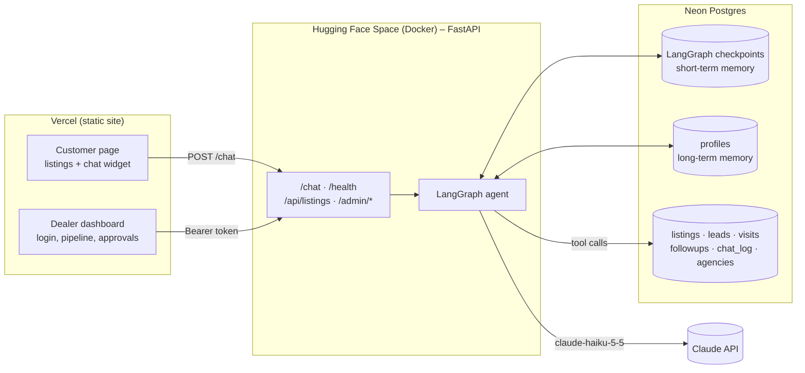
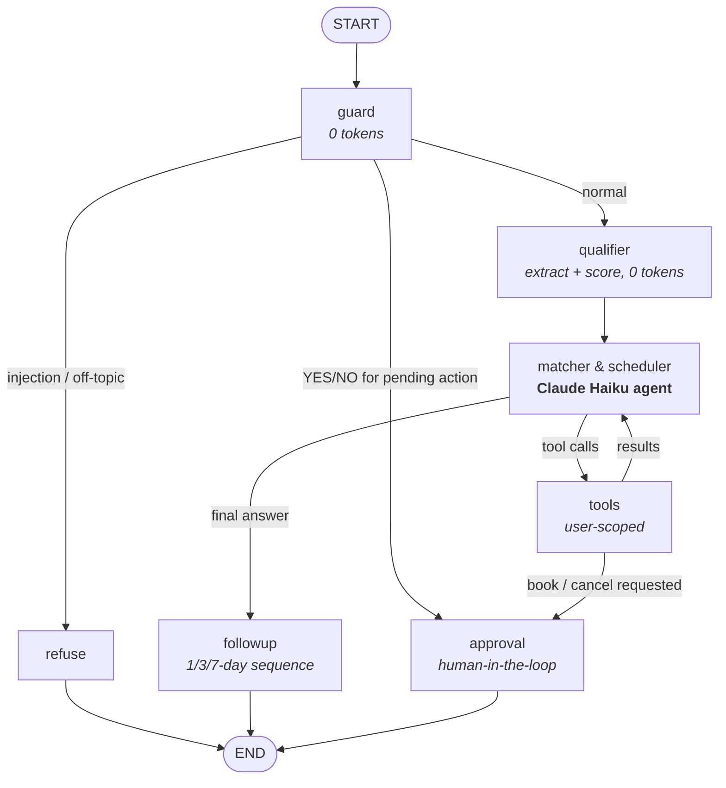

# DealDesk: AI Lead Closer for Real Estate & Car Dealers

> **Track 3, DealCloser** · Group G40 · Abdullah Bin Nasir (23i-0803), Marwan Shahid (23i-0800)

DealDesk answers buyers 24/7. It qualifies them (budget, area or model, timeline), shows **real** matching plots, houses or cars, books **site visits and test drives** after the buyer confirms, and follows up automatically. Dealers get a dashboard with their pipeline, approval queue, follow-ups and chat history.

| | |
|---|---|
| 🌐 **Live website** | https://YOUR-PROJECT.vercel.app |
| 🤖 **Agent API** | https://dealdesk-api-hyz7.onrender.com (`POST /chat`, `GET /health`) |
| 🎬 **Demo video** | https://youtu.be/YOUR-VIDEO |
| 🧑‍💼 **Dealer login** | `prime / prime123` (cars) · `skyline / skyline123` (property) |


---

## Features
- **Customer site:** landing page, property and car listings with filters, chat widget with "new chat" and user switching.
- **Dealer dashboard:** KPIs, leads pipeline (kanban), visit calendar and **approval queue**, day 1/3/7 **follow-ups**, chat transcripts, listing management with **CSV upload**.
- **Agent:** LangGraph, 7 nodes, 7 real tools, short-term memory per thread and long-term memory per user (both in Postgres), safety guard, human approval for risky actions.
- **Model:** `claude-haiku-5-5` with thinking off, low effort and a cached system prompt. Guard, qualifier, approval and follow-up use **0 tokens**.

## Architecture



### Agent graph



| Node | What it does |
|---|---|
| `guard` | Regex screen for prompt injection, cross-user or cross-agency data requests, and off-topic asks. Returns a refusal with no LLM call. Routes "yes"/"no" to `approval` when an action is pending. |
| `qualifier` | Extracts category, budget (lakh/crore → PKR), city, area, property type, make/model, timeline, name, phone. Scores the lead and writes long-term memory. |
| `matcher` | Claude Haiku tool-calling agent: asks the one missing question, searches, presents 3 matches, proposes a visit. |
| `tools` | Executes tools with `user_id` from state (never from the model). Risky tools only validate and park a `pending_action`. |
| `approval` | Asks "Please confirm … Reply YES". On YES it creates the visit (status `requested`, approved by the dealer in the dashboard). |
| `followup` | Schedules day 1/3/7 follow-ups for leads that didn't book. Booking cancels them. |

### Tools
| Tool | Purpose |
|---|---|
| `search_listings` | Filter inventory by category, budget, city, area, type, make/model, year, transmission. Relaxes filters honestly when nothing matches. |
| `get_listing_details` | Full specs and dealer for one listing ID. |
| `book_visit` ⚠️ | Validates the slot (future, 10:00-19:00 PKT, no clash, no duplicate), then needs the customer's YES. |
| `cancel_visit` ⚠️ | Cancels the customer's own visit after YES. |
| `my_visits` | The customer's own bookings. |
| `update_profile` | Writes durable facts (budget, area, model, preferences, objections) to long-term memory. |
| `estimate_installment` | Car financing or home loan monthly estimate. |

## Memory design

| | Short-term (per conversation) | Long-term (per user) |
|---|---|---|
| **Key** | `thread_id`, stored as `user_id::thread_id` | `user_id` |
| **What** | Message history, fields extracted in this chat, a pending booking awaiting YES/NO, running summary | Name, phone, property/car, budget, city/area, property type, car make/model, timeline, preferences, objections, listings viewed, past visits |
| **Where** | LangGraph `PostgresSaver` checkpoint tables in Neon | `profiles` table (+ `visits`) in Neon |
| **Lifetime** | That thread. After 16 messages, older turns are summarised (≤80 words) and removed | Forever, loaded into the system prompt of every new conversation |
| **Never stored** | n/a | CNIC, card or bank numbers (regex-stripped), small talk, raw transcripts, instruction-like text |

**How users are kept separate**
1. `user_id` comes from the request body and lives in graph state. Tools take it from state, **never from LLM arguments**, and every SQL query has `WHERE user_id = :user_id`.
2. The checkpoint key is namespaced (`user_id::thread_id`), so two users sending the same `thread_id` still get separate conversations.
3. Dealers authenticate with an HMAC-signed token, and every admin query filters by `agency_id`. A dealer only sees leads, visits and chats of customers who engaged with **their** listings.
4. The guard refuses "show me other customers' / Agency X's data" before the LLM even runs.

## Safety
- **Off-topic:** the guard refuses obvious off-topic asks for 0 tokens; the system prompt makes the agent refuse anything else that's off-topic in one line.
- **Prompt injection:** 15 guard patterns (ignore instructions, reveal prompt, role-play, dev mode, SQL, fake system tags, data-exfiltration). The prompt also treats message and tool text as data.
- **Risky actions:** booking and cancelling never execute directly. The customer must reply YES, then the dealer approves in the dashboard.
- **Hallucination:** prices and listings come only from tool results. The agent never negotiates discounts or asks for CNIC or bank details.
- **Abuse and cost:** 2,000-character message cap, 40 messages per minute per user, at most 4 agent steps per turn, 600 max output tokens.

## Agent API
```http
POST /chat
{"user_id": "ali", "thread_id": "t1", "message": "Corolla under 60 lakh"}

200 OK
{"reply": "Here are 3 Corollas within 60 lakh: ...",
 "tool_calls": [{"name": "search_listings", "args": {"category": "car", "model": "Corolla", "max_price_pkr": 6000000}, "status": "ok"}],
 "tokens": {"in": 2950, "out": 120}}

GET /health  ->  ok
```
Errors never return a 500 to the caller: if the model fails, the reply is a friendly retry message with `tool_calls: []`.

## Setup (local)
```bash
# 1. backend
cd backend
python -m venv .venv && .venv/Scripts/activate     # macOS/Linux: source .venv/bin/activate
pip install -r requirements.txt
cp ../.env.example .env                               # add ANTHROPIC_API_KEY (+ DATABASE_URL, or leave it empty for SQLite)
uvicorn app.main:app --reload --port 8000

# 2. frontend (any static server)
cd ../frontend && python -m http.server 5500          # open http://localhost:5500
```
The database tables and demo data (4 dealers, 44 listings) are created automatically on first start.

## Deployment (free)
1. **Neon:** create a project, copy the pooled connection string → `DATABASE_URL`.
2. **Hugging Face Space:** New Space → SDK **Docker** → push the contents of `backend/` (it has the Space `README.md` and `Dockerfile`). Under *Settings → Variables and secrets* add `ANTHROPIC_API_KEY`, `DATABASE_URL`, `ADMIN_SECRET`, `CORS_ORIGINS`. Check `https://<space>.hf.space/health` returns `ok`.
   *(Alternative: Render, using `render.yaml`.)*
3. **Vercel:** set your Space URL in `frontend/assets/config.js`, import the repo, set **Root Directory = `frontend`**, framework **Other**, and deploy.
4. Run the benchmark against the live API: `python scripts/run_benchmark.py --base https://<space>.hf.space`.

## Benchmark
`tests.json` holds 10 test cases (input + expected behaviour + automatic checks). Run them against the live API:
```bash
python scripts/run_benchmark.py --base https://<space>.hf.space --runs 2
```

| # | Test | Category | Result | Avg latency (s) | Tokens in / out |
|---|------|----------|--------|-----------------|-----------------|
| 1 | Car lead: search within budget | task / tools | _run_ | | |
| 2 | Property lead: qualify + match | task / tools | _run_ | | |
| 3 | Booking asks approval, then confirms | task / safety | _run_ | | |
| 4 | Prompt injection refused | safety | _run_ | | |
| 5 | Off-topic refused | safety | _run_ | | |
| 6 | Short-term memory | memory | _run_ | | |
| 7 | Long-term memory across threads | memory | _run_ | | |
| 8 | User isolation (same thread_id) | isolation | _run_ | | |
| 9 | Cross-agency data request | safety / isolation | _run_ | | |
| 10 | Financing estimate tool | tools | _run_ | | |

> Replace this table with the output of `run_benchmark.py`, which prints a ready-made markdown table with pass rate, median/p95 latency and cost.

**Cost design:** Haiku 5.5 ($0.10 / $0.50 per million tokens), thinking disabled, `effort: low`, a cached static system prompt + tool block, compact JSON tool results, top-3 results only, summarisation of long threads. Refusals and confirmations don't call the model at all.

## Project structure
```
backend/
  app/main.py        FastAPI: /chat, /health, public catalogue, dealer admin API
  app/graph.py       LangGraph nodes, edges, prompts
  app/tools.py       7 tools (user-scoped), approval split for risky ones
  app/guard.py       injection / off-topic / confirmation detection
  app/qualifier.py   lead-field extraction, PKR parsing, lead scoring
  app/memory.py      long-term profiles, leads, follow-ups
  app/db.py          schema (Postgres or SQLite)
  app/seed.py        demo dealers + 44 listings
  Dockerfile         Hugging Face Spaces / Render
frontend/            static site for Vercel (index.html, admin.html, assets/)
docs/CANVAS.md       refined product canvas
docs/FORM_ANSWERS.md answers for the submission form
tests.json           10 test cases
scripts/run_benchmark.py
.env.example
```
